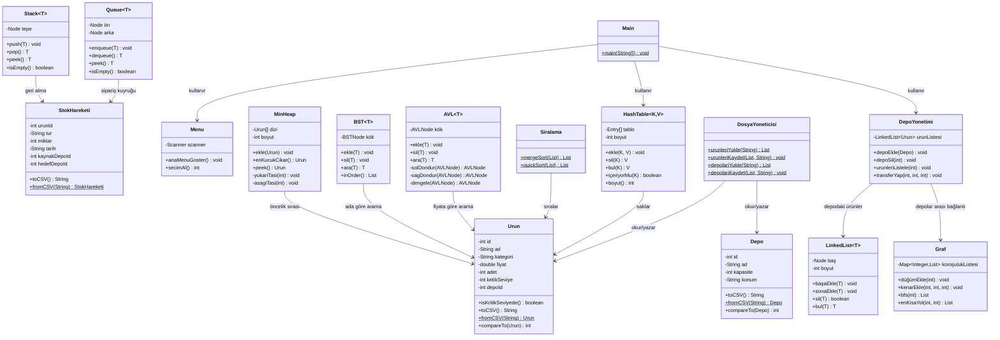

# 📦 DataWatchers — Ürün ve Depo Stok Yönetim Sistemi

> **Proje Kodu:** VY-022  
> **Ders:** Veri Yapıları — Güz 2026  
> **Takım:** DataWatchers  
> **Depo:** [github.com/Zeki-krdg/DataWatchers](https://github.com/Zeki-krdg/DataWatchers)

## 📝 Kısa Tanım

Birden fazla depodaki ürünlerin stok giriş/çıkış, transfer, arama, sıralama ve raporlama işlemlerini **temel veri yapıları** kullanarak yöneten konsol tabanlı bir Java uygulamasıdır. Veriler CSV dosyalarında saklanır; tüm veri yapıları (Hash Table, BST, AVL, Stack, Queue, Min-Heap, Graf, Bağlı Liste) ekip tarafından sıfırdan yazılmaktadır.

---

## 👥 Ekip Üyeleri

| # | Ad Soyad | Öğrenci No | GitHub | Rol |
|---|----------|------------|--------|-----|
| 1 | **Muhammed Zeki Karadağ** | 02240201162 | [@Zeki-krdg](https://github.com/Zeki-krdg) | Ekip Koordinatörü — Çekirdek model & veri katmanı |
| 2 | **Avaşin Adar Bayram** | 02240201207 | [@adarbayram](https://github.com/adarbayram) | Depo yönetimi, menü arayüzü, test & dokümantasyon |
| 3 | **Muzaffer Kalay** | 02240201174 | [@muzafferKalay](https://github.com/muzafferKalay) | Stok işlemleri (Stack, Queue, Heap) |
| 4 | **Fırat Yağan** | 02240201150 | [@firatyagan](https://github.com/firatyagan) | Arama, sıralama & raporlama |

---

## 🛠️ Kullanılan Teknoloji

| Öğe | Seçim |
|-----|-------|
| Dil | Java 17+ |
| Arayüz | Konsol (CLI) — `Scanner` tabanlı menü |
| Veri saklama | CSV dosyaları (`data/` klasörü) |
| Derleme | `javac` (IDE bağımsız) |
| Sürüm kontrolü | Git + GitHub |

> **Not:** JavaFX veya Swing kullanılmamaktadır; proje tamamen konsol üzerinden çalışır.

---

## 🎯 Temel İşlevler ve Kullanılan Veri Yapıları

Aşağıdaki tablo her işlevi, o işlev için seçilen veri yapısını ve tercih gerekçesini özetler.

| # | İşlev | Veri Yapısı | Neden Bu Yapı? |
|---|-------|-------------|----------------|
| 1 | **Ürün ekleme / silme / güncelleme** | **Hash Table** (anahtar: `urunId`) | Ürüne ID ile erişim **O(1)** ortalama sürede gerçekleşir; binlerce ürün arasında doğrudan erişim gerektiğinde en verimli yapıdır. |
| 2 | **Depodaki ürünleri tutma** | **Bağlı Liste** (Linked List) | Deponun ürün listesi sık sık baştan/aradan ekleme-çıkarma yapılır; bağlı liste bu işlemleri **O(1)** düğüm referansıyla yapar, dizi kaydırmaya gerek kalmaz. |
| 3 | **Stok giriş / çıkış kaydı** | **Stack** (LIFO) | Son yapılan işlemi geri almak (undo) için doğal yapıdır; en son eklenen hareket en önce geri alınır. |
| 4 | **Sipariş / talep işleme** | **Queue** (FIFO) | Siparişler gelme sırasına göre işlenmelidir; kuyruk ilk gelen-ilk çıkar prensibiyle adaleti sağlar. |
| 5 | **Kritik stok uyarısı** | **Min-Heap** (öncelik kuyruğu) | Stok adedi en düşük ürünü **O(1)**'de almak, yeni ürün eklemek **O(log n)**'de yapılabilir; sürekli sıralı liste tutmaktan çok daha verimlidir. |
| 6 | **Ürün arama (ada / fiyata göre)** | **BST / AVL Ağacı** | Sıralı veri üzerinde arama, minimum/maksimum bulma **O(log n)** sürede yapılır. AVL dengeleme sayesinde en kötü durum da logaritmik kalır. |
| 7 | **Sıralama** | **Merge Sort / Quick Sort** | Karşılaştırmalı sıralama algoritmaları arasında **O(n log n)** ortalama performans sunar; kendi yazımımız olarak uygulanacaktır. |
| 8 | **Depolar arası mesafe / rota** | **Graf** (komşuluk listesi) | Depolar düğüm, aralarındaki bağlantılar kenar olarak modellenir; en kısa yol veya bağlantı kontrolü graf algoritmaları ile doğal şekilde çözülür. |
| 9 | **Veri kalıcılığı (dosya I/O)** | **CSV dosyaları** | Hafif, okunabilir, ek kütüphane gerektirmez; küçük-orta ölçekli projeler için yeterlidir. |

---

## 🏗️ Klasör Yapısı

```
DataWatchers/
├── README.md                  # Bu dosya
├── docs/                      # Dokümantasyon, rapor, sunum
│
├── src/                       # Kaynak kodlar (paketlere göre)
│   ├── model/                 # Varlık (entity) sınıfları
│   │   ├── Urun.java
│   │   ├── Depo.java
│   │   └── StokHareketi.java
│   │
│   ├── veri/                  # Veri erişim katmanı
│   │   ├── HashTable.java
│   │   └── DosyaYoneticisi.java
│   │
│   ├── depo/                  # Depo yönetim katmanı
│   │   ├── DepoYonetimi.java
│   │   └── Graf.java
│   │
│   ├── islem/                 # Stok işlem katmanı
│   │   ├── Stack.java
│   │   ├── Queue.java
│   │   └── Heap.java
│   │
│   ├── arama/                 # Arama & sıralama katmanı
│   │   ├── BST.java
│   │   ├── AVL.java
│   │   └── Siralama.java
│   │
│   └── main/                  # Uygulama giriş noktası
│       ├── Main.java
│       └── Menu.java
│
├── test/                      # Birim testleri
│   ├── HashTableTest.java
│   ├── StackTest.java
│   ├── QueueTest.java
│   ├── HeapTest.java
│   ├── BSTTest.java
│   └── GrafTest.java
│
└── data/                      # CSV veri dosyaları
    ├── urunler.csv
    └── depolar.csv
```

---

## 📐 UML Sınıf Diyagramı



---

## 📋 İş Bölümü (Görev Dağılımı)

### 1️⃣ Muhammed Zeki Karadağ — Çekirdek Model & Veri Katmanı *(Ekip Koordinatörü)*

| Görev | Dosya(lar) | Durum |
|-------|-----------|-------|
| `Urun` sınıfını yazmak | `model/Urun.java` | ✅ Tamamlandı |
| `Depo` sınıfını yazmak | `model/Depo.java` | ✅ Tamamlandı |
| `StokHareketi` sınıfını yazmak | `model/StokHareketi.java` | ✅ Tamamlandı |
| Ürünler için **Hash Table** yazmak | `veri/HashTable.java` | 🔲 Yapılacak |
| CSV dosyasına kaydetme / yükleme | `veri/DosyaYoneticisi.java` | 🔲 Yapılacak |
| Git deposunu kurmak, ortak arayüzleri belirlemek | — | ✅ Tamamlandı |

### 2️⃣ Avaşin Adar Bayram — Depo Yönetimi, Menü Arayüzü, Test & Dokümantasyon

| Görev | Dosya(lar) | Durum |
|-------|-----------|-------|
| Depo ekleme / silme işlemleri | `depo/DepoYonetimi.java` | 🔲 Yapılacak |
| Depodaki ürünleri **bağlı listeyle** tutma | `depo/DepoYonetimi.java` | 🔲 Yapılacak |
| Depolar arası transfer *(opsiyonel: Graf)* | `depo/Graf.java` | 🔲 Yapılacak |
| Konsol menüsü (ana program) | `main/Menu.java`, `main/Main.java` | 🔲 Yapılacak |
| Test senaryoları yazma | `test/*.java` | 🔲 Yapılacak |
| Rapor ve sunum hazırlamak | `docs/` | 🔲 Yapılacak |

### 3️⃣ Muzaffer Kalay — Stok İşlemleri (Stack, Queue, Heap)

| Görev | Dosya(lar) | Durum |
|-------|-----------|-------|
| Stok giriş / çıkış işlemleri | `islem/` | 🔲 Yapılacak |
| **Stack** ile geri alma (undo) | `islem/Stack.java` | 🔲 Yapılacak |
| **Queue** ile sipariş işleme | `islem/Queue.java` | 🔲 Yapılacak |
| **Min-Heap** ile kritik stok uyarısı | `islem/Heap.java` | 🔲 Yapılacak |

### 4️⃣ Fırat Yağan — Arama, Sıralama & Raporlama

| Görev | Dosya(lar) | Durum |
|-------|-----------|-------|
| Ürünleri ada göre tutan **BST** | `arama/BST.java` | 🔲 Yapılacak |
| Ürünleri fiyata göre tutan **AVL** | `arama/AVL.java` | 🔲 Yapılacak |
| Sıralama algoritmaları (Merge Sort / Quick Sort) | `arama/Siralama.java` | 🔲 Yapılacak |
| Rapor: fiyata göre sıralı liste | `arama/Siralama.java` | 🔲 Yapılacak |
| Rapor: fiyat aralığı sorgusu | `arama/BST.java` veya `AVL.java` | 🔲 Yapılacak |
| Rapor: kategoriye göre filtreleme | `arama/` | 🔲 Yapılacak |

---

## ▶️ Derleme ve Çalıştırma

```bash
# Tüm kaynak dosyaları derle
javac -d out src/**/*.java

# Uygulamayı çalıştır
java -cp out main.Main
```

---

## 📂 Veri Dosyaları

### `data/urunler.csv`
```
id,ad,kategori,fiyat,adet,kritikSeviye,depoId
101,Laptop,Elektronik,25000.0,15,5,1
102,Kablosuz Mouse,Elektronik,450.0,3,10,1
...
```

### `data/depolar.csv`
```
id,ad,kapasite,konum
1,Merkez Depo,1000,Istanbul
2,Ege Deposu,500,Izmir
3,Anadolu Deposu,750,Ankara
```

---

## 📄 Lisans

Bu proje İnönü Üniversitesi Veri Yapıları dersi kapsamında geliştirilmektedir.
